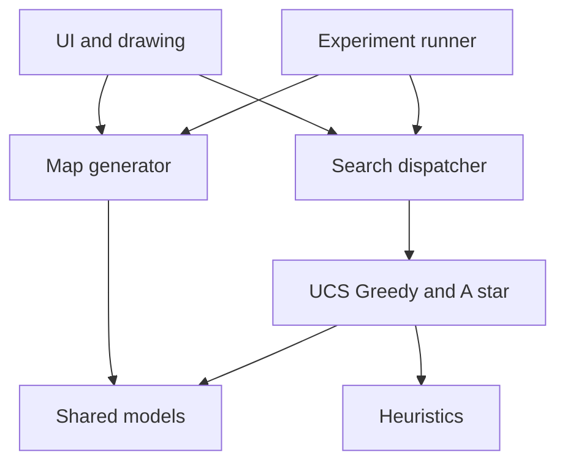

# Intelligent Route-Planning Agent

SOFE 3720U Group 2: a Python simulation comparing UCS, Greedy Best-First Search
and A* on generated weighted road networks.

## Current status

**Starter scaffold, not a completed agent.** Shared models, a dispatcher, an
example graph and contract checks are implemented. Map generation, searches,
Euclidean heuristic, GUI, experiments and analysis are explicitly TODO and raise
NotImplementedError until their owners implement them. Test-file TODOs are not
completed tests. No performance results have been collected.

## Setup

Use Python 3.11. From the repository root:

```bash
python -m venv .venv
```

Activate with `.venv\Scripts\activate` on Windows, or
`source .venv/bin/activate` on macOS/Linux. Then:

```bash
python -m pip install -r requirements.txt
python main.py --status
python -m unittest discover -v
```

`python main.py` will launch the UI after Member 4 implements it; currently it
prints a clear pending-implementation message and exits with code 2.
Tkinter is included in many Python installations; Linux may need an OS package.

## Architecture



UI and experiments call `run_search` from `search.py`. Each algorithm accepts a
Graph and returns SearchResult. The UI owns all drawing; batch experiments run
without a display. See CONTRIBUTING.md for the common rules.

## File ownership

Member labels remain placeholders until the group assigns names.

| Files | Owner | Deliverable |
| --- | --- | --- |
| models.py | Member 2, team-reviewed contracts | Shared types and dataclasses |
| map_generator.py | Member 2 | Validated reproducible maps |
| configs/experiments.json | Member 2 | Reusable experiment conditions |
| algorithms/astar.py, heuristics.py | Gaetano | A* and heuristics |
| search.py, README.md | Gaetano | Dispatcher, architecture and coordination |
| algorithms/ucs.py, algorithms/common.py | Member 3 | UCS and shared reconstruction |
| experiments.py, analyse_results.py | Member 3 | CSV automation and baseline charts |
| algorithms/greedy.py | Member 4 | Greedy search |
| ui.py, visualization.py, main.py | Member 4 | Controls, display and application entry |
| requirements.txt, .gitignore | Member 4 | Dependencies and exclusions |
| tests/test_astar.py, tests/test_heuristics.py | Gaetano | Own component tests |
| tests/test_map_generator.py | Member 2 | Map tests |
| tests/fixtures.py, tests/test_ucs.py, tests/test_contracts.py | Member 3 | Baseline and shared fixtures |
| tests/test_search_correctness.py, tests/test_integration.py | Member 3 | Shared checks and integration |
| tests/test_greedy.py | Member 4 | Greedy tests and manual UI acceptance |

Each owner integrates and repairs their own component. All members contribute
to analysis, charts, review and presentations. Gaetano coordinates integration.

## Shared vocabulary and contracts

| Name | Meaning |
| --- | --- |
| graph | Complete fixed road network |
| node / node_id | Integer intersection ID |
| position | Coordinate tuple |
| edge_cost | Cost of one road |
| neighbour | Directly connected node |
| start / goal | Initial node / destination |
| path / cost | Ordered route / summed road costs |
| g_score | Best known cost from start |
| heuristic / h_value | Estimated remaining cost |
| frontier / priority | Candidate queue / selection value |
| came_from | Predecessors for reconstruction |
| nodes_expanded | Valid non-goal expansions, excluding stale entries |
| execution_time | Search duration in seconds |
| instance_id / seed | Fixed problem identifier / generation seed |

Public interface:

```python
generate_map(config) -> Graph
ucs(graph, start, goal) -> SearchResult
greedy(graph, start, goal, heuristic) -> SearchResult
astar(graph, start, goal, heuristic) -> SearchResult
run_search(graph, start, goal, algorithm, heuristic="euclidean") -> SearchResult
```

Algorithms: `ucs`, `greedy`, `astar`. Heuristics: `euclidean`, `zero`.
UCS ignores heuristic selection; record `none` for it in CSV.
Models and exact typed function signatures are in the source files.

## Implementation order

1. Confirm models together. Use tests/fixtures.py while maps are being built.
2. Implement owned components against those contracts. UI can use a clearly
   labelled mock SearchResult during development, never as an experimental result.
3. Add correctness tests and integrate components; owners resolve their defects.
4. Automate controlled experiments using configs/experiments.json and export
   the fields in experiments.CSV_FIELDS to results/.
5. Analyse costs, expansions, success rates and timing variation; explain why.

The JSON is an initial plan, not a claim that its runner or start/goal policy
is implemented. Test reachable and unreachable instances, near/far pairs,
different sizes/densities/cost variation, and A* zero versus Euclidean.

Progress presentation: week of October 19, 2026. Final presentation and separate
demonstration: week of November 30, 2026, according to the supplied handout.
